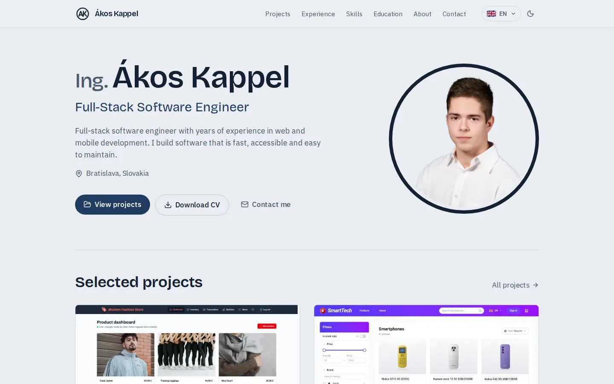
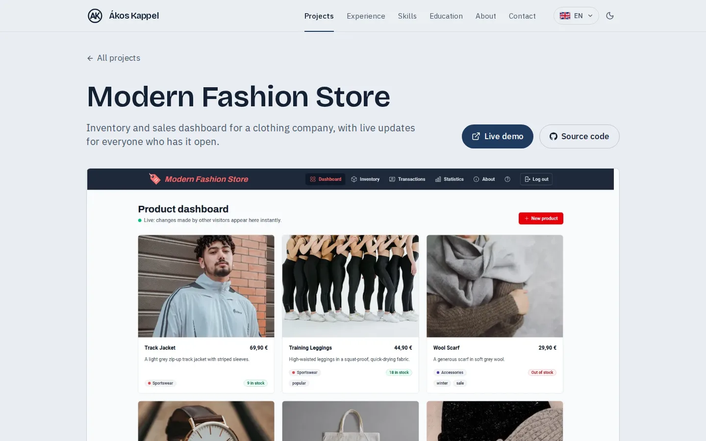
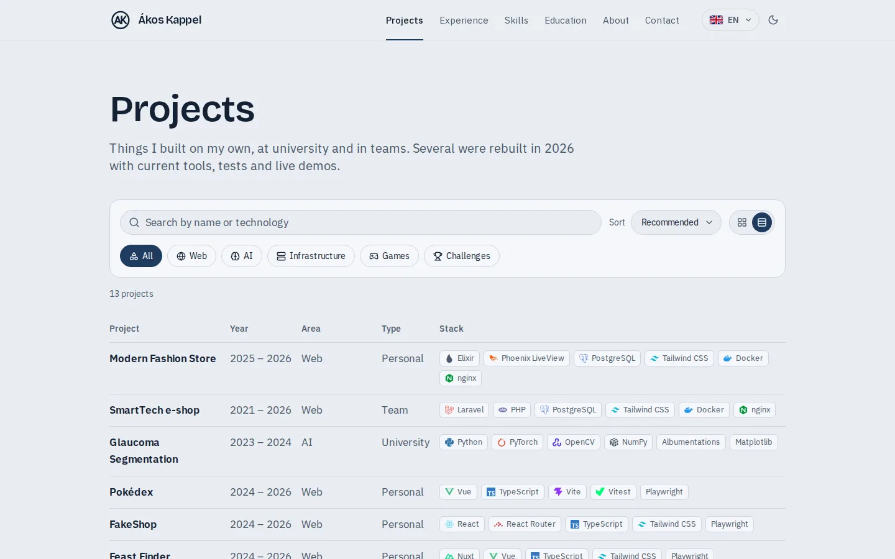
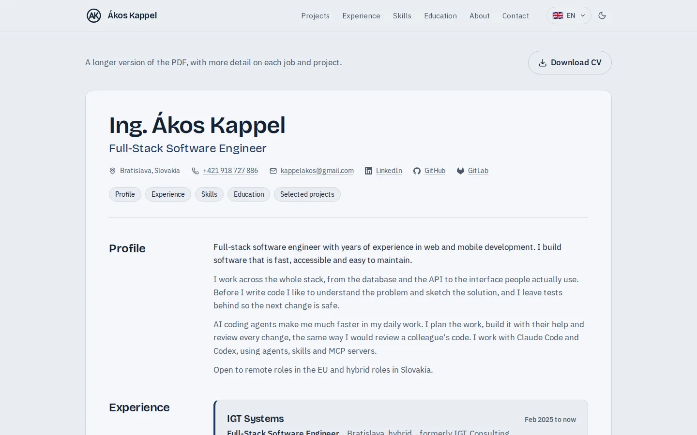
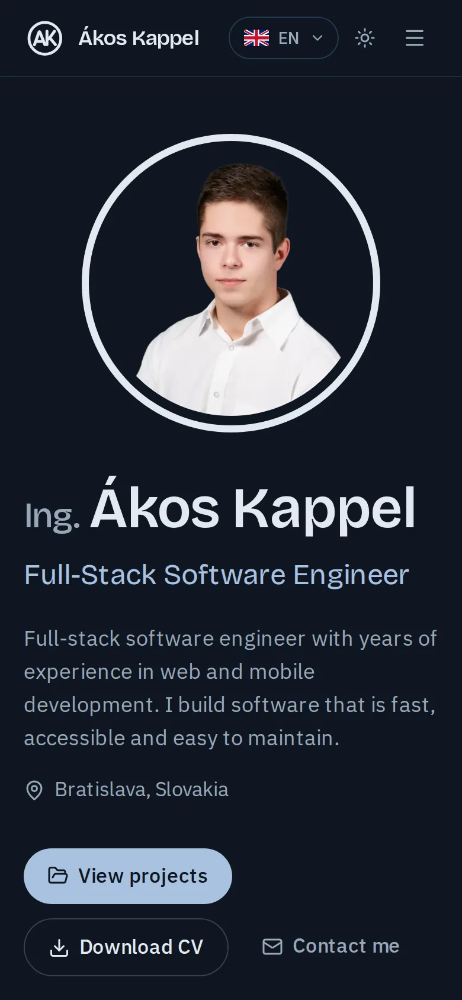

# Portfolio

[](https://github.com/AkosKappel/portfolio/actions/workflows/ci.yml)
[](https://portfolio-taupe-eta-51.vercel.app)


Personal website of Ákos Kappel, full-stack software engineer: projects with case studies, experience, skills, education, contact and a CV in English and Slovak.

**Live:** https://portfolio-taupe-eta-51.vercel.app · **CV:** [web](https://portfolio-taupe-eta-51.vercel.app/cv) · [PDF](https://portfolio-taupe-eta-51.vercel.app/cv/pdf)

<picture>
  <source media="(prefers-color-scheme: dark)" srcset=".github/readme/home-dark.webp">
  
</picture>

## Features

- Every page statically generated in English and Slovak, with `hreflang`, a localized sitemap, structured data and a generated link preview per page
- Case studies with architecture diagrams, galleries in an accessible lightbox and what changed in each 2026 rebuild
- Projects archive with fuzzy search, filters, sorting, grid and table views, all kept in the URL
- Light and dark mode with five themes each, without a flash, view transitions between pages and from a project card into its case study, scroll-driven reveals in CSS
- A WebGL2 particle background that reacts to the pointer, and a colophon page on how the site is built, with an accessibility statement
- An activity page with one contribution calendar across personal and work GitHub and GitLab activity, with filters, streaks, breakdowns by type and source, commit times and languages per year, refreshed weekly by a workflow
- Contact form with a shared Zod schema, honeypot and rate limit, sent from a Server Action
- CV as an HTML page with print styles and as a shareable PDF viewer
- WCAG 2.2 AA: axe checks every page in both themes on desktop and mobile; Lighthouse CI keeps performance, accessibility, best practices and SEO budgets

## Screenshots

| Case study | Projects archive | CV | Mobile |
| --- | --- | --- | --- |
|  |  |  |  |

## Stack

- Next.js 16 (App Router, every page statically generated), React 19, TypeScript
- Tailwind CSS 4 with design tokens in `src/app/globals.css`, light and dark themes
- next-intl for English (at `/`) and Slovak (at `/sk`), with `hreflang` links and a localized sitemap
- Simple Icons for technology logos, lucide for UI icons
- TanStack Table and match-sorter for the projects archive (fuzzy search, filters and sorting kept in the URL)
- TanStack Form with a shared Zod schema for the contact form, sent from a Server Action through Resend
- React `ViewTransition` for route and image transitions
- Biome for linting and formatting, Vitest for content checks, Playwright with axe for end-to-end and accessibility tests, Lighthouse CI

## Development

Requires Node 24 (see `.nvmrc`).

```bash
npm install
npm run dev
```

| Script | What it does |
| --- | --- |
| `npm run lint` | Biome lint and format check |
| `npm run check` | Biome with safe fixes applied |
| `npm run typecheck` | TypeScript |
| `npm test` | Vitest content and helper tests |
| `npm run check:links` | Requests every external link in `src/content/` (projects, demos, profiles, theses); also runs weekly on GitHub |
| `npm run build` | Production build |
| `npm run analyze` | Turbopack bundle analyzer in the browser (per route, client and server) |
| `npm run test:e2e` | Playwright against the production build (run `npm run build` first) |
| `npm run activity` | Refreshes `src/content/activity.json` for the activity page (see below) |
| `npm run lighthouse` | Lighthouse CI against the production build, with a 300 KB budget for compressed JavaScript per page |
| `npm run lighthouse -- --config=lighthouserc.mobile.json` | Mobile Lighthouse report (throttled phone); CI shows its scores in the run summary without failing |

GitHub Actions runs all of these on every push and pull request. Vercel builds and deploys `main`.

## Contact form

The form on `/contact` sends e-mail through the [Resend](https://resend.com) HTTP API from a Server Action. Set these environment variables in Vercel (or `.env.local`):

| Variable | Required | Default |
| --- | --- | --- |
| `RESEND_API_KEY` | yes | none; without it the form answers with an error and points to the e-mail address |
| `CONTACT_TO_EMAIL` | no | the address in `src/content/site.ts` |
| `CONTACT_FROM_EMAIL` | no | `Portfolio <onboarding@resend.dev>`, which only delivers to the Resend account owner; set a sender on a verified domain otherwise |

Spam protection: a hidden honeypot field and at most five messages per IP address in ten minutes (counted per server instance).

## Activity

`/activity` renders `src/content/activity.json`, which `npm run activity` (`scripts/activity.mts`) writes from:

- GitHub GraphQL: commits, pull requests, reviews, issues and new repositories. Uses `GITHUB_TOKEN` or the `gh` CLI login.
- GitLab events API on gitlab.com (`GITLAB_TOKEN`) and the IGT instance (`IGT_GITLAB_TOKEN`), both with the `read_api` scope: merge requests, approvals, issues and comments. GitLab keeps events for three years.
- Work repositories checked out next to this project (`../IGT-systems`, `../Svarba`, `../SoftPoint`): commits by author, each counted once even after a rebase.

Besides daily counts, it stores commits per weekday and hour (from GitHub and the work repositories, in Central European time) and each year's languages: lines changed per language for work repositories, the repository's languages for GitHub.

The file is public, so it holds only counts, never repository or project names. A collector without its token or repository folder is skipped and its source keeps the previous data, so jobs without access stay in the history. Run it locally for the work sources (they need the VPN or the repositories), then commit the JSON.

The `Activity` workflow refreshes the personal sources every Monday and commits the JSON, which Vercel then deploys. It needs two repository secrets: `ACTIVITY_GITHUB_TOKEN` (a classic token with `read:user` and `repo`, so private contributions count) and `ACTIVITY_GITLAB_TOKEN` (a gitlab.com token with read access to events).

## Structure

```text
messages/       UI text per language (en.json, sk.json)
src/
  app/[locale]/ pages, rendered statically for every language
  app/          sitemap, robots, icons and Open Graph image
  components/   layout (header, footer, theme, language), projects, ui
  content/      typed site content with English and Slovak text
  i18n/         routing, navigation and request config for next-intl
  lib/          small helpers (dates, metadata, technology logos)
test/e2e/       Playwright tests
latex/          CV source (English and Slovak)
scripts/        CV build (PDFs and page images)
.github/        CI, weekly link check, Dependabot, README screenshots
```

## Editing content

Page content lives in `src/content/` with every text in both languages (`{ en, sk }`), and interface text lives in `messages/`. `src/content/content.test.ts` checks slugs, image paths, links, dates, missing translations and that both message files have the same keys.

Technology names in `stack` and `skills` get a logo when they are listed in `src/lib/tech-icons.ts`.

### Adding a project

1. Take a screenshot at 1600 px width (16:10 works best on cards), convert it to WebP and save it as `public/images/projects/<slug>.webp`:

   ```bash
   magick screenshot.png -resize '1600x>' -quality 80 public/images/projects/<slug>.webp
   ```

2. Add an entry to `src/content/projects.ts`: `slug`, `title`, a one-sentence `summary`, `description` paragraphs, `kind`, `area`, `year`, `stack`, links and `image` with its real width and height. Use `until` for the last year of work (e.g. a 2026 rebuild) and set `featured` to show it on the home page.
3. Write `summary`, `description` and `highlights` in English and Slovak, then run `npm test`. The card, case-study page, sitemap entry, search and filters follow from the entry.

Projects without a screenshot get a generated placeholder.

## CV

The CV source is LaTeX in `latex/` (`main-english.tex`, `main-slovak.tex`, A4, one page, shared layout in `cv-style.tex`). Build both PDFs, copy them to `public/` and render the page images for the viewer (needs `latexmk`, `pdftoppm` and ImageMagick):

```bash
./scripts/build-cv.sh
```

If the page count changes, update `pages` in `site.cv` (`src/content/site.ts`); `npm test` fails until it matches the rendered images.

The public CV contains no birth date or street address. Two pages show it:

- `/cv` renders the same content as HTML from `src/content/`, with print styles.
- `/cv/pdf` (and `/sk/cv/pdf`) shows the PDF itself, for sharing a link instead of a file. Desktop browsers get their built-in PDF viewer; phones and tablets get the page images.
